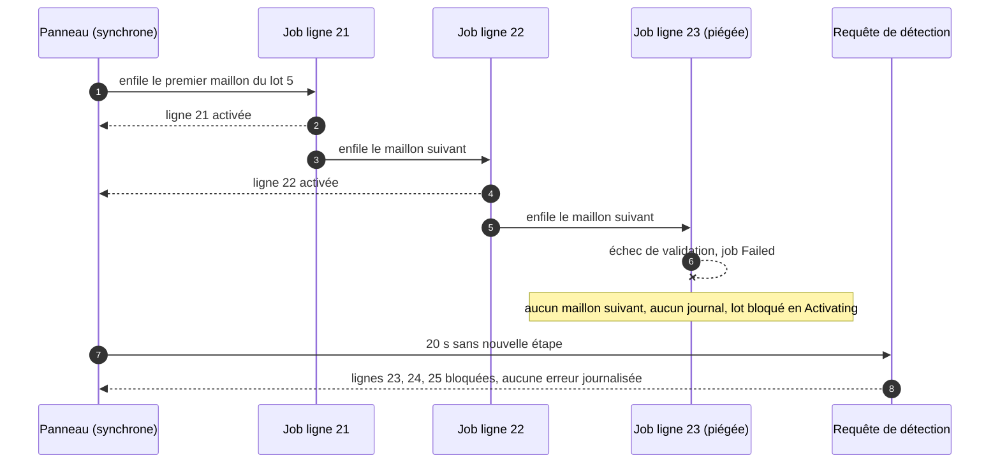
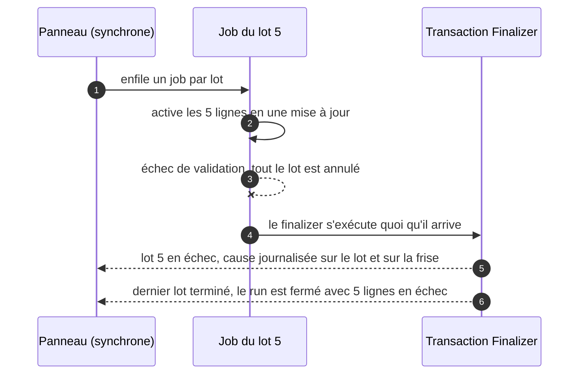

# Démo « Chaîne asynchrone silencieuse »

## Contexte (anonymisé)

Un équipementier industriel B2B active les lignes de ses commandes après validation. Les lignes sont regroupées en lots ;
l'activation, trop lourde pour une transaction synchrone, est confiée à des jobs asynchrones (Queueable).

## Symptôme

Certaines commandes restent indéfiniment « en cours d'activation » : une partie des lignes est active, les autres jamais.
Aucune erreur n'est remontée aux utilisateurs ni journalisée par l'application.

## Hypothèse et preuve

Chaque ligne est activée par son propre job, qui enchaîne le job de la ligne suivante. Si un job échoue, il n'enchaîne pas
la suite : la chaîne s'arrête en silence. La démo le prouve en direct :

- chaque job publie la ligne qu'il a activée (`Demo_Step__e.Rows_Done__c`) : les tuiles du panneau s'allument une à une ;
- avec **Chaos**, une ligne piégée (sans prix unitaire, refusée par une règle de validation) fait échouer son job ;
- aucun acteur ne ferme le run : il reste « Running ». Après 20 s sans nouvelle étape, le panneau interroge la
  **requête de détection** (`AsyncOrderStrategy.inspect`) : lignes encore _Pending_ dans des lots encore _Activating_,
  alors qu'aucun job n'est en file. Le run est alors fermé « Failed », avec les lignes bloquées en rouge.

## Cause racine

Une chaîne de Queueables sans gestion d'erreur ne laisse qu'une seule trace d'un échec : un job « Failed » dans
_Setup > Apex Jobs_, que personne ne surveille. L'état métier reste intermédiaire, car chaque job a déjà validé sa propre ligne.

Contrainte de plateforme : en Developer Edition (vitrine et scratch orgs de la CI), une chaîne compte **au plus 5 jobs**.
La démo utilise donc des lots de 5 lignes, avec une chaîne par lot.

### AVANT : un job par ligne, enchaîné

### APRÈS : un job par lot, une mise à jour, un Transaction Finalizer

## Solution

- **Un job par lot** au lieu d'un job par ligne : les 5 lignes et le lot sont mis à jour dans la même transaction,
  il n'existe plus d'état intermédiaire possible (tout le lot, ou rien).
- **Transaction Finalizer** (`BundleActivationFinalizer`) : il s'exécute après le job, même en cas d'exception non gérée.
  Il marque le lot _Failed_ avec la cause et publie l'échec ; le dernier lot terminé ferme le run.
- **Clôture du run sérialisée** : la commande est verrouillée (`FOR UPDATE`) avant de compter les lots restants, pour que
  deux lots qui finissent en même temps ne se croient pas mutuellement encore en cours.
- La **requête de détection** reste utile en production : c'est la supervision qui aurait révélé le défaut d'origine.

## Résultat mesuré

Tests Apex (`AsyncOrderStrategyTest`, `LineActivationChainJobTest`, `BundleActivationJobTest`, `BundleActivationFinalizerTest`) :

- AVANT sans Chaos : 20 lignes, **20 jobs** (un par ligne), toutes actives ;
- AVANT avec Chaos : la chaîne du lot piégé s'arrête, **aucun événement de clôture**, 3 lignes restent bloquées ; la détection
  les retrouve (`3 lines stuck`) et ferme le run en échec ;
- APRÈS sans Chaos : 100 lignes, **20 jobs** (un par lot), toutes actives, run fermé par le dernier finalizer ;
- APRÈS avec Chaos : le lot piégé est annulé en entier (0 ligne active sur 5), marqué _Failed_ avec la cause, **0 ligne bloquée**.

Limite des tests Apex : un test n'exécute qu'un niveau de Queueable, et `Test.stopTest()` s'arrête au premier job en échec.
L'enchaînement est donc rejoué maillon par maillon (`AsyncChain`), et l'isolement entre lots est prouvé par le run réel de la CI
(`run-demos.js --chaos-demo Async_Chain_Break`) et par les captures Playwright `docs/screenshots/async-chain-break/`.

## Compétences démontrées

Apex asynchrone (Queueable, chaînage, limites de profondeur), Transaction Finalizers, atomicité transactionnelle, supervision
par requête de détection, verrouillage d'enregistrement, progression temps réel par Platform Events (`empApi`).
