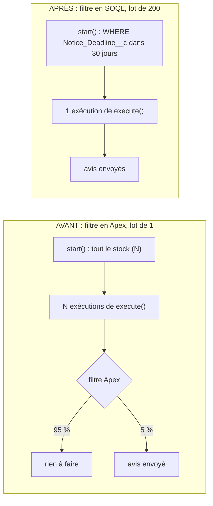

# Démo « Batch : filtre Apex vs SOQL »

## Contexte (anonymisé)

Un équipementier industriel B2B gère des contrats de maintenance avec tacite reconduction. Chaque nuit, un batch repère
les contrats dont la date limite de préavis approche et marque l'avis de renouvellement comme envoyé. Environ 5 % du stock
est concerné chaque nuit.

## Symptôme

Le batch dure de plus en plus longtemps à mesure que le stock grossit, alors que le nombre d'avis envoyés reste stable.
_Setup > Apex Jobs_ montre des milliers de lots traités pour quelques dizaines d'avis.

## Hypothèse et preuve

Le batch parcourt tout le stock et décide en Apex, enregistrement par enregistrement, s'il faut agir. La démo lance les deux
versions **en même temps** (bouton _Race_ du panneau), chacune sur son propre stock (`Lane__c`), et mesure dans `AsyncApexJob`
le nombre d'exécutions (`JobItemsProcessed`) et la durée jusqu'au `finish()`.

## Cause racine

- `start()` ne filtre pas : la `QueryLocator` renvoie tout le stock ;
- taille de lot 1 : une transaction (et sa file d'attente) par enregistrement ;
- le filtre (statut, avis non envoyé, date limite de préavis dans les 30 jours) est évalué dans `execute()`.

Le coût suit la taille du stock, pas le nombre d'avis à envoyer.

## Solution

- Le filtre est déplacé dans la requête de `start()`, sur la formule `Notice_Deadline__c`
  (`ADDMONTHS(Start_Date__c, Term_Months__c) - Notice_Days__c`) : la base ne renvoie que les contrats concernés ;
- taille de lot 200 : quelques dizaines d'avis tiennent dans **une** exécution.

Les deux versions envoient exactement les mêmes avis : `RenewalNoticeBatchAfterTest` compare les enregistrements notifiés
par chaque version.

## Résultat mesuré

Tests Apex (200 contrats par couloir) :

- AVANT : **200 exécutions** pour 10 avis envoyés ;
- APRÈS : **1 exécution** pour les mêmes 10 avis.

Durées et exécutions mesurées par la CI (scratch org, 1 000 contrats par couloir) : voir le tableau de `PLAN.md`, Phase 5,
et le résumé du job. Captures de la course : `docs/screenshots/batch-filter/race.png` (APRÈS terminé, AVANT en cours)
et `race-finished.png`.

Limite des tests Apex : un test n'exécute qu'un seul `execute()` par `Database.executeBatch`. L'AVANT (lot de 1) est donc
rejoué comme la plateforme le ferait : `start()`, un `execute()` par enregistrement, `finish()`.

## Compétences démontrées

Batch Apex (`QueryLocator`, taille de lot, `Database.Stateful`, `finish`), filtre sur champ formule en SOQL, mesure par
`AsyncApexJob`, comparaison d'implémentations en parallèle sur données isolées.
