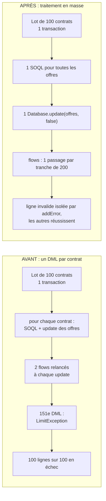

# Démo « Lot Bulk tout-ou-rien »

## Contexte (anonymisé)

Un équipementier industriel B2B reçoit chaque nuit de son ERP un fichier de contrats à activer, chargé par la Bulk API.
Activer un contrat active ses offres (_deals_) ; chaque offre activée est journalisée par deux flows.

## Symptôme

Certains matins, **aucun** contrat du fichier n'est activé, alors qu'un seul pose problème. Le résultat du job Bulk API
indique la même erreur de limite sur toutes les lignes. Recharger le fichier « à la main » par petits paquets fonctionne.

## Hypothèse et preuve

Toutes les lignes d'un lot Bulk API (jusqu'à 200) passent dans **une seule transaction** de trigger. Si le coût du trigger
croît avec le nombre de lignes, une limite finit par casser, et la plateforme annule tout le lot. La démo le prouve deux fois :

- par un **vrai job Bulk API 2.0** (`scripts/bulk-demo.js` : `sf data upsert bulk`, puis lecture des résultats ligne par ligne
  du job et jointure avec la mesure du run) ;
- depuis le panneau (transaction synchrone), avec une tuile par ligne du lot (composant `rowGrid`) qui bascule en échec.

Un job Bulk ne transporte aucun paramètre : le mode est choisi par ligne (`Processing_Mode__c` dans le CSV).

## Cause racine

Le trigger AVANT traite les contrats un par un : une requête et un `update` des offres par contrat. Chaque `update` relance
les deux flows after-save, soit environ 3 SOQL et 3 DML par contrat. Le coût suit le nombre de lignes, et la transaction casse
sur `Too many DML statements: 151`. Une `LimitException` ne peut pas être interceptée : tout le lot échoue, y compris les
lignes valides.

## Solution

- Une seule requête pour toutes les offres du lot, un seul `Database.update(offres, false)` en succès partiel ;
- une offre refusée (règle de validation) ne fait échouer **que son contrat**, par `addError` ;
- l'échec est journalisé dans `Demo_Run__c` (`Records_Failed__c`, message) via `Demo_Step__e`, qui survit au rollback.

Piège découvert pendant la démo : en succès partiel, la plateforme **rejoue le trigger** sur les lignes valides et les
variables statiques survivent entre les tentatives. Une garde anti-récursion par `Set` statique sauterait ces lignes :
la garde porte donc sur la transition _Draft → Active_.

## Résultat mesuré

Mesuré par la CI (scratch org), vrai job Bulk API de 100 lignes :

- AVANT : **100 lignes sur 100 en échec**, `Too many DML statements: 151` ;
- APRÈS : **100 sur 100 réussies**, 3 SOQL et 3 DML pour tout le lot ;
- APRÈS avec Chaos (une offre sans montant) : **99 réussies, 1 en échec**, avec la cause de la règle de validation.

Les chiffres de chaque exécution sont dans le résumé du job de CI (`bulk.md`) et sur la page de la démo.
Un trigger lancé par la Bulk API s'exécute avec les limites asynchrones (200 SOQL au lieu de 100) : c'est pourquoi le vrai job
utilise 100 lignes, là où le panneau casse dès 50.

## Compétences démontrées

Bulk API 2.0, transactions et limites de gouverneur, bulkification d'un trigger, succès partiel (`Database.update(…, false)`,
`addError`), coût des flows record-triggered par tranche de 200, journalisation qui survit au rollback (Platform Events).
