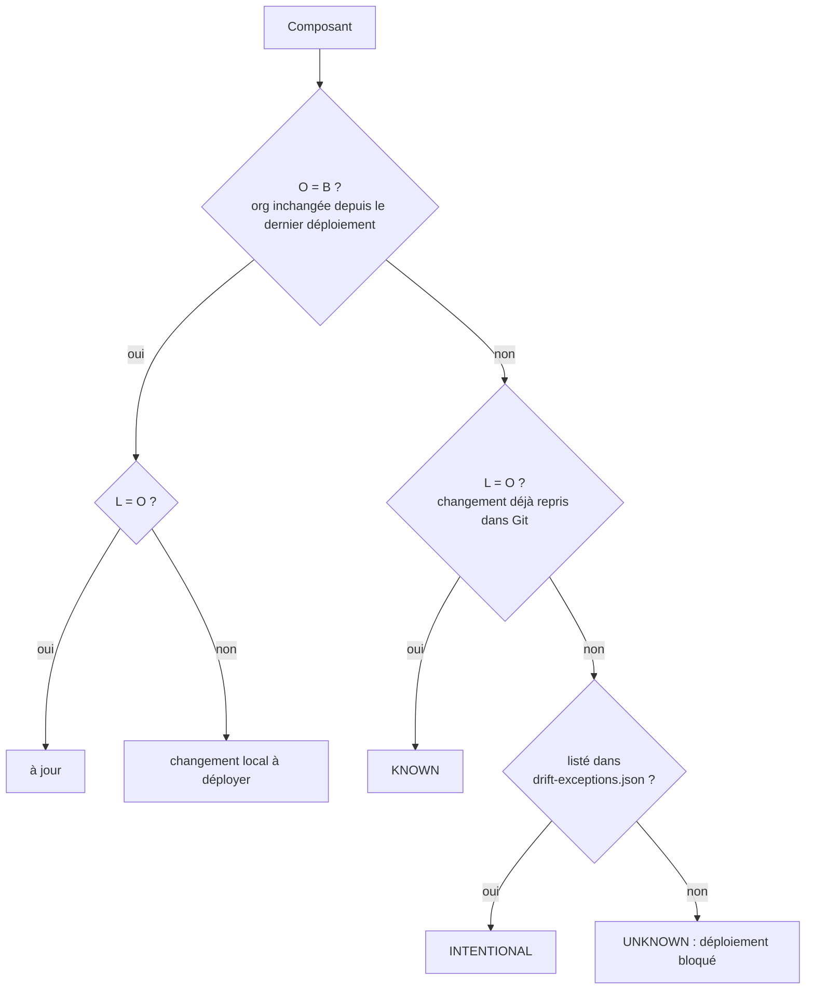

# Outillage DevOps : fraîcheur, drift et garde de déploiement

## Contexte (anonymisé)

Dans une org partagée, quelqu'un corrige une classe en urgence directement dans l'org, depuis un poste de travail, sans passer
par Git. Le déploiement suivant, fait depuis la branche principale, écrase ce correctif sans que personne ne le remarque.
Le bug revient en production.

## Symptôme

Un correctif « disparaît » après un déploiement. L'historique Git ne montre rien : le changement n'y a jamais été.

## Mécanisme

Trois versions de chaque composant sont comparées par empreinte SHA-256 (fins de ligne, BOM et espaces finaux normalisés) :

- **L** : la copie de travail locale, celle qu'un déploiement enverrait ;
- **O** : l'org, lue par l'API Tooling (`ApexClass.Body`, `ApexTrigger.Body`, `LightningComponentResource.Source`)
  avec l'auteur et la date de la dernière modification ;
- **B** : la référence, c'est-à-dire le contenu au dernier tag Git `deploy/<alias>/<date>` posé par un déploiement.

Pas de fichier d'état à maintenir : le tag Git **est** l'état de l'org au dernier déploiement.

Périmètre : Apex (classes, triggers) et LWC. L'org restitue ce code octet pour octet (mesuré sur la vitrine : 93 composants
identiques). Les métadonnées XML (flows, objets) sont réécrites par l'org et demanderaient une normalisation : hors périmètre.

Sans tag de référence, tout écart est `UNKNOWN` : rien ne prouve quel côté est le plus récent.

## Commandes

| Commande                                                 | Rôle                                                                              | Code de sortie               |
| -------------------------------------------------------- | --------------------------------------------------------------------------------- | ---------------------------- |
| `node tools/freshness.js --target-org <alias>`           | la version locale est-elle celle de l'org ? (`fresh` / `stale` / `missing`)       | 0 tout à jour, 1 sinon       |
| `node tools/drift.js --target-org <alias> [--out <dir>]` | classe les écarts depuis le dernier tag ; rapports `drift.md` / `drift.json`      | 2 si un `UNKNOWN` existe     |
| `node tools/deploy.js --target-org <alias> [--dry-run]`  | garde, puis déploiement des package directories, puis tag `deploy/<alias>/<date>` | 2 si bloqué                  |
| `node tools/deploy.js … --force --reason "…"`            | passe outre ; la raison est écrite dans le message du tag                         |                              |
| `node tools/baseline.js --target-org <alias>`            | adopte une org déjà déployée : tag posé seulement si tout est `fresh`             | 2 si l'org diffère du commit |

`deploy.js` et `baseline.js` refusent de tourner si les package directories ont des modifications non committées :
le tag doit décrire exactement ce qui a été déployé.

## Preuve

La CI rejoue le scénario dans la scratch org à chaque exécution (étape _Drift and deployment guard_) :

1. `freshness` : tous les composants déployés sont `fresh` ; `baseline` pose le tag ; `deploy --dry-run` est autorisé ;
2. un « hotfix » est déployé directement depuis l'espace de travail sur `DemoCatalog`, puis annulé dans Git ;
3. `drift` sort `ApexClass:DemoCatalog` en **UNKNOWN**, avec l'auteur et la date de la modification dans l'org (code 2) ;
4. `deploy` **refuse** de déployer (code 2). Rapports `drift.md` / `drift.json` et `deploy-guard.md` publiés en artefact
   et dans le résumé du job.

La logique de classement est couverte par des tests unitaires (`node --test`, matrice complète L / O / B), exécutés en CI.

## Compétences démontrées

API Tooling, ALM Salesforce sans outil tiers, traçabilité des déploiements par tags Git, conception de garde-fous
testables (fonctions pures et test d'intégration en scratch org).
