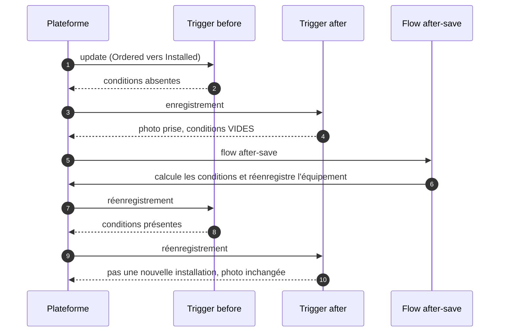
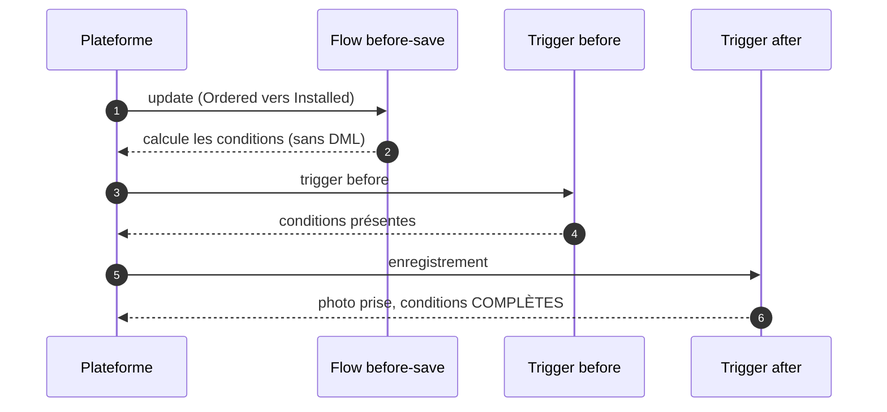

# Démo « Ordre d'exécution trigger / flow »

## Contexte (anonymisé)

Un équipementier industriel B2B installe du matériel chez ses clients. À l'installation, une « photo » de l'équipement
est archivée avec ses conditions de service : fin de garantie, niveau de service et prochaine maintenance. Ces conditions
sont calculées par un flow ; la photo est prise par un trigger Apex.

## Symptôme

Les sauvegardes réussissent, aucune erreur n'est remontée, mais les photos archivées ont des conditions de service **vides**,
alors que les équipements, eux, les ont bien.

## Hypothèse et preuve

Le flow et le trigger s'exécutent dans la même transaction, mais pas dans l'ordre supposé. La démo le prouve en instrumentant
chaque acteur : le trigger _before_, le trigger _after_ et le flow publient une étape `Demo_Step__e` avec ce qu'ils voient.
La frise du panneau reconstitue alors l'ordre réel de la transaction (séquence commune à tous les acteurs du run).

## Cause racine

Ordre d'exécution d'un `update` (extrait) : flows record-triggered **before-save** → triggers **before** → validation →
enregistrement → triggers **after** → … → flows record-triggered **after-save**.
Un flow after-save tourne donc **après** le trigger after : la photo est prise avant que les conditions existent.
Quand le flow met ensuite à jour l'équipement, la plateforme le réenregistre et rejoue les triggers. Mais l'équipement
n'est plus une _nouvelle_ installation (`Trigger.old` est déjà _Installed_), donc aucune nouvelle photo n'est prise.

### AVANT : calcul dans un flow after-save

### APRÈS : calcul dans un flow before-save

## Solution

Le calcul porte sur l'enregistrement déclencheur : il a sa place dans un **flow before-save** (mise à jour rapide de champ).
Les valeurs existent avant le trigger, et la transaction économise un DML ainsi qu'un réenregistrement complet de l'équipement.

Alternative écartée : garder le flow after-save et rafraîchir la photo au réenregistrement. Elle corrige le symptôme mais
conserve le double enregistrement, et fait dépendre la photo d'un détail de l'ordre d'exécution.

Dans l'org, les deux versions coexistent : `Processing_Mode__c` sur chaque équipement choisit le flow
(`Asset_Demo_Service_Terms_After_Save` pour AVANT, `Asset_Demo_Service_Terms_Before_Save` pour APRÈS). Le trigger est identique.

## Résultat mesuré

Tests Apex (`AssetInstallationStrategyTest`), 200 équipements :

- AVANT : la sauvegarde réussit, **200 photos sur 200 ont leurs 3 champs vides**, alors que les 200 équipements portent les bonnes
  valeurs (calculées par le flow, mais trop tard) ;
- APRÈS : **200 photos sur 200** égales aux valeurs attendues, recalculées en Apex ;
- l'ordre publié sur la frise est vérifié étape par étape : en AVANT, trigger before → trigger after (photo vide) → flow after-save →
  trigger before (réenregistrement) → trigger after (pas de nouvelle photo) ; en APRÈS, trigger before (conditions présentes) →
  trigger after (photo complète).

Captures AVANT/APRÈS et GIF : générés par la CI dans `docs/screenshots/order-of-execution/` (artefact `proof-<sha>`).

## Compétences démontrées

Ordre d'exécution de la plateforme, choix flow before-save / after-save, instrumentation d'une transaction (Platform Events
_publish immediately_, action invocable appelée par un flow), tests Apex qui prouvent un bug silencieux.
